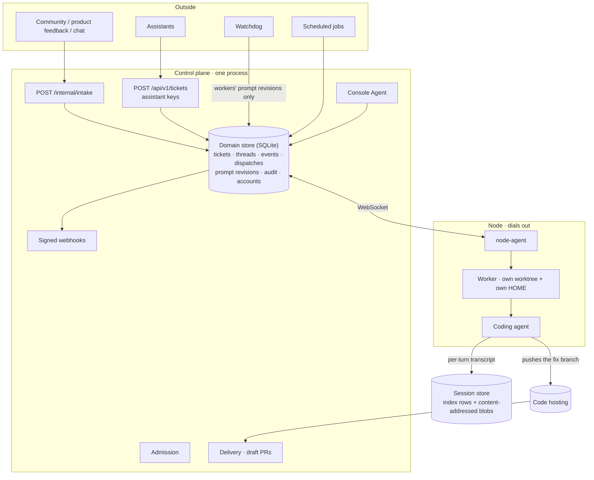

# Architecture

> This describes the code in `services/`. Everything here maps to something in the
> repository; ideas that were considered but are not implemented are listed in the last
> section instead of being implied along the way.

## One sentence

Skein does not write code. It turns external feedback into tickets, dispatches them to
isolated coding-agent sessions on nodes, and hands the result — a branch, commits, a draft
pull request — back to a person to accept.

## Overview



## Three parts

### Control plane (`services/control`)

A single Python process and the **only writer** (SQLite in WAL mode, one process writes).

| Module | Responsibility |
| --- | --- |
| `access.py` | The permission matrix: roles, permissions, which route needs which permission |
| `api.py` | HTTP surface: sessions, tickets, intake, Agent, transcripts, metrics, logs |
| `auth.py` + `auth_providers/` | Login: token / local / external provider; pluggable |
| `accounts.py`, `sessions.py`, `passwords.py` | Users, identities, roles; Skein-issued sessions; scrypt |
| `assistants.py`, `public_api.py`, `assistants_api.py` | Assistant credentials, `/api/v1`, management endpoints |
| `notify.py` | Status webhooks with per-assistant HMAC signatures |
| `admission.py` | Admission: code decides ignore / record / process before any model is asked |
| `channel.py` | Node channel: register, heartbeat, create worker, dispatch, report |
| `scheduler.py` | Node selection, capacity, dispatch state |
| `agent.py` | Console Agent: natural-language read, dispatch/cancel only when asked |
| `forge.py` | Opens draft PRs through a pluggable code-hosting client |
| `prompts.py` | Prompt revisions: stable and canary pointers separated |
| `watchdog.py` / `watchdog_agent.py` | External control loop: facts → signals → tickets (optional) |
| `driver.py` / `runs.py` | Scheduled jobs and their run records |
| `session_store.py` | Transcript index rows + content-addressed files |
| `metrics.py`, `logbuf.py` | Prometheus counts; in-process log ring and optional JSON logs |
| `integrations/` | Optional integrations, mounted only when configured |

### Node agent (`services/node-agent`)

A Node process that **dials out** to the control plane (WebSocket), so a node needs no
inbound port and can sit behind NAT. On the node:

- one worker per ticket: its own `git worktree` (`wt-<workerId>`) and its own HOME
  (`home-<workerId>`);
- a worker is a coding-agent session that edits code in its worktree, commits to a fix
  branch and pushes it;
- when the ticket finishes or is cancelled the worktree and HOME are removed — the **fix
  branch stays in the shared repository** (the PR needs it);
- cancelling kills the whole process group (SIGTERM, SIGKILL 10 seconds later): a stuck
  worker keeps burning model budget otherwise;
- workers do **not** inherit the control plane's token or URL (`worker-env.mjs`).

### Node channel protocol

One WebSocket between control plane and node (`/api/agent/channel`); messages are JSON
distinguished by `t`. The node dials in and registers first:

```text
node → control plane
  node.register   {node_id, token, name, host, platforms[], max_workers, peer_url}
  node.heartbeat  every 15 seconds
  worker.created  {worker_id, session_id}
  worker.create_failed {worker_id, reason}
  ack             {ticket_id, worker_id}
  nack            {ticket_id, worker_id, reason}
  progress        {ticket_id, worker_id, step, message, pct}
  result          {ticket_id, worker_id, result{ok, branch, commits, diffstat, pushed, summary, …}}

control plane → node
  node.registered {node_id}
  worker.create   {worker_id, platform, repo}
  dispatch        {worker_id, ticket{id, code, title, summary, platform, …}}
  cancel          {ticket_id, worker_id}
  error           {reason}
```

Conventions:

- **One worker per ticket.** Every dispatch creates a fresh session; it is cleaned up at the
  end. There is no cross-ticket continuation.
- The control plane keeps no durable node state: no heartbeat for 60 seconds means offline;
  a reconnecting node registers again.
- `repo` may be empty — the node resolves the platform name with its own `REPO_MAP`, so
  repository locations can live only on the node.
- Nodes also have `peer.*` / `room.*` messages to discover and talk to each other directly
  (worker-to-worker); the control plane only relays as a fallback.

### Console (`services/console`)

Vue 3 single-page app, served by the control plane at `/console/`. Three work surfaces:
Today, Tickets, Operations — and an admin-facing Agent. Data arrives as SSE snapshots
(`/internal/stream`) with polling as the fallback. Controls are shown or hidden from the
permissions in `/api/session`; the server still enforces every call.

## Three sources of truth

Each owns one thing; they are never merged:

| Source | Content | Where |
| --- | --- | --- |
| Domain | tickets, threads, events, dispatches, prompt revisions, audit, runs | SQLite (one file) |
| Session | transcripts, turns, `head_sha`, branch | index rows in the domain store + content-addressed files (named by `sha256`) |
| Code | fix branches | the code-hosting platform; Skein reads state and opens PRs, never merges |

Principles: transcripts (big bytes) never go into SQLite; tickets are not copied anywhere
else; **Skein never merges code on anyone's behalf**.

## Admission before models

External messages are classified by **code** (`admission.decide`), not by a model:

```text
source disabled        → IGNORE
mention required, none → policy: drop, or record only
mentioned, too short   → RECORD
on the allow list      → PROCESS / RECORD
```

The inputs are the source, whether the agent was mentioned, text length and the allow
list — all deterministic. Model judgement is spent on "how to fix this ticket", not on "is
this message worth answering". Admission policies are data (the `kv` table), not prompt
text, and the Watchdog cannot change them.

## The Watchdog's write access is a narrow slit

The Watchdog is a separate process (`skein.watchdog_agent`) that works through the control
plane's HTTP API and has **no access to the domain store**. Its only write is to propose a
prompt revision (`prompts.propose(…)`), constrained (validation lives in the control plane,
not in the Watchdog):

| Constraint | Implementation |
| --- | --- |
| Only allow-listed parts | `runtime/worker`, `runtime/work`, `runtime/handoff/worker`, hard-coded |
| Optimistic lock | `base_revision` must equal the current stable revision |
| Bounded change | more than 2 000 characters of diff from stable is rejected |
| Canary first | a new revision only moves the canary pointer |
| Too many rollbacks freeze it | two rollbacks in 7 days freeze the part; only a human source unfreezes |
| Signals must be facts | only facts already in the domain store (dispatch timeouts, failed runs) |
| Fully audited | every propose/promote/rollback/freeze is an audit row |

The point is the constraints: the Watchdog cannot change its own prompt, admission, or the
tool allow list, and a bad suggestion goes to the canary at worst.

> **Status:** the revision machinery is **not wired to workers**. A worker's instructions
> are built into the node agent (`WORKER_RULES`); it does not read the `prompts` table. With
> `SKEIN_WATCHDOG_AUTO=1` the Watchdog will record revisions that change nothing.
> Promote/rollback/unfreeze also have no entry point yet (no route, no CLI). Do not enable
> `SKEIN_WATCHDOG_AUTO` until that is wired.

## Transcripts are synced per turn

When a worker finishes a turn, the node uploads that turn's transcript
(`POST /internal/worker/turn`); the control plane stores it content-addressed and writes an
index row.

- **Per turn, not per task** — a crash mid-task leaves completed turns on record.
- **Idempotent**: the key is `(session_id, turn_index)` plus the content hash; the same hash
  again is a no-op, a different hash for the same turn is `409`.
- Upload failures queue on the node and retry; they never block the worker.
- Credentials, dependency directories and the whole workspace are *not* synced — git owns
  the code (it is on the branch), the transcript is the thing worth keeping.

## The Agent's tool boundary

The console Agent (`agent.py`) is a natural-language entry point for admins. Two
boundaries:

- **Read by default**: its tools are queries. Dispatch and cancel happen only on an explicit
  request.
- **Tool results go back to the model as text.** The model never executes anything; actions
  run in control-plane code and pass the same checks as the HTTP API (platform must be
  valid, ticket must exist, no double dispatch).

## Explicitly not done

- Not merging code or making release decisions for a person.
- Not letting the Watchdog change admission, tool lists, outward wording or its own prompt.
- Not using a model to decide whether a prompt revision got worse — rollbacks are driven by
  facts.
- Not syncing credentials, dependency directories or whole workspaces.
- Not binding the core to one identity provider, one code host or one deployment.

## Prototyped, not implemented

- **Prompt revisions are not wired to workers** (see the status note above).
- **Router-style direct answers** (the chat's first message restricted to `say | dispatch`)
  — the chat path is an optional transparent proxy, without that wrapper.
- **Cross-node session continuation** — every ticket gets a fresh worker, cleaned up at the
  end.
- **A general outbox and outward acknowledgements** — outward writes today are draft PRs
  and signed status webhooks.
- **Automatic canary observation windows and auto-rollback.**
- **One-shot deploy as an execution backend** — nodes dialing in is the only shape.
