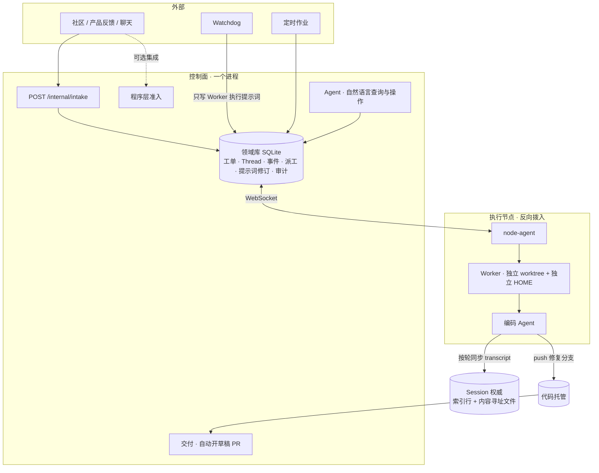
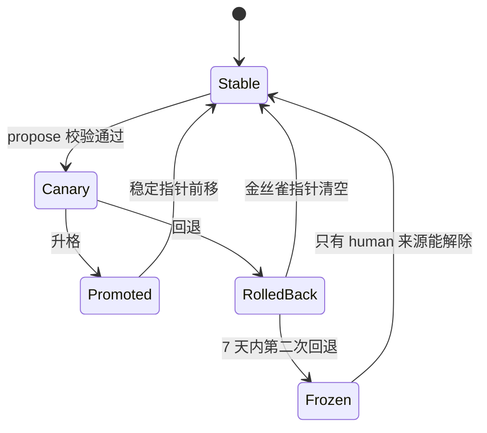

# 架构

> 以当前实现（`services/`）为准。文中每条都能在代码里对上；原型阶段设想但尚未实现的部分单列在最后一节。

## 1. 一句话

雁阵自己不写代码。它把外部反馈变成工单，派给节点上隔离的编码 Agent 会话，
把结果（分支、提交、草稿 PR）交回给人来决定。

## 2. 总图



## 3. 三个部分

### 控制面（`services/control`）

一个 Python 进程，是**唯一的写入者**（SQLite 以 WAL 模式打开，只有一个进程写）。

| 模块 | 职责 |
| --- | --- |
| `api.py` | HTTP 接口：登录会话、工单、外部入口建单、Agent、transcript 上传 |
| `auth.py` + `auth_providers/` | 登录鉴权。令牌模式 / SSO 模式；provider 可插拔 |
| `admission.py` | 程序层准入：事件进来先由代码判断忽略 / 只记账 / 处理 |
| `channel.py` | 节点通道：注册、心跳、建 worker、派单、回报 |
| `scheduler.py` | 节点挑选、容量、派工状态 |
| `agent.py` | 控制台 Agent：管理员用自然语言查状态、按明确要求派单/取消 |
| `forge.py` | worker 推上分支后，用代码托管的 API 开草稿 PR |
| `prompts.py` | 提示词修订：稳定指针与金丝雀指针分离 |
| `watchdog.py` / `watchdog_agent.py` | 外部控制回路：从领域库的事实产生信号、建单、（可选）提议提示词修订 |
| `driver.py` / `runs.py` | 定时作业驱动与运行留痕 |
| `session_store.py` | Session 权威：transcript 的索引行与内容寻址文件 |
| `integrations/` | 可选集成，由环境变量决定是否挂载 |

### 执行节点（`services/node-agent`）

一个 Node 进程，**反向拨入**控制面（WebSocket），所以节点不需要入站端口、可以在 NAT 后面。
节点上：

- 每张工单一个 worker：独立的 git worktree（`wt-<workerId>`）+ 独立的 HOME（`home-<workerId>`）；
- worker 就是一个编码 Agent 会话，在 worktree 里改代码、提交到修复分支、推送；
- 单子结束或取消后自动清理 worktree 与 HOME；**修复分支留在共享仓库里**，供开 PR 用；
- 取消派单时终止整个进程组（SIGTERM，10 秒后 SIGKILL）——卡死的 worker 会持续消耗模型额度；
- worker **不继承**控制面的令牌与地址（`worker-env.mjs`）。

### 节点通道协议

控制面与节点之间是一条 WebSocket（`/api/agent/channel`），消息都是 JSON，用 `t` 字段区分类型。
节点**主动拨入**并先注册：

```text
节点 → 控制面
  node.register   {node_id, token, name, host, platforms[], max_workers, peer_url}
  node.heartbeat  每 15 秒一次
  worker.created  {worker_id, session_id}              worker 会话已建立
  worker.create_failed {worker_id, reason}             建不出来（并发满 / 仓库不存在 / …）
  ack             {ticket_id, worker_id}               已接单开始执行
  nack            {ticket_id, worker_id, reason}       拒单（会话不存在 / 忙）
  progress        {ticket_id, worker_id, step, message, pct}
  result          {ticket_id, worker_id, result{ok, branch, commits, diffstat, pushed, summary, …}}

控制面 → 节点
  node.registered {node_id}                            注册成功
  worker.create   {worker_id, platform, repo}          为一次派工建 worker
  dispatch        {worker_id, ticket{id, code, title, summary, platform, …}}
  cancel          {ticket_id, worker_id}               取消：终止进程组并清理沙箱
  error           {reason}                              注册被拒
```

几个约定：

- **一张工单一个 worker**：每次派单都 `worker.create` 一个新会话，结束后清理；不做跨单续接。
- 控制面不持有节点的持久状态：超过 60 秒没收到心跳就算离线，重连后重新注册。
- `repo` 可以为空——节点用自己的 `REPO_MAP` 把平台名解析成本地路径，所以仓库位置可以只在节点上配。
- 节点之间还有一套 `peer.*` / `room.*` 直连消息（worker 之间互相发现与通信），控制面只做兜底转发。

### 控制台（`services/console`）

Vue 3 单页应用，由控制面托管在 `/console/`。三个工作面：工作台、需求、运行。
数据靠 SSE 实时快照（`/internal/stream`），断流时退回轮询。

## 4. 三份权威

各管一处，互不合并：

| 权威 | 内容 | 位置 |
| --- | --- | --- |
| 领域 | 工单、Thread、事件、派工、提示词修订、审计、运行记录 | SQLite（一个文件） |
| Session | transcript、轮次、`head_sha`、分支 | 索引行在领域库 + 内容寻址文件（`sha256` 命名） |
| 代码 | 修复分支 | 代码托管平台；雁阵只读状态、只开 PR，不合入 |

原则：大字段（transcript 字节）不进 SQLite；工单不复制到别处；**雁阵不代替人合入代码**。

## 5. 准入先于模型

外部消息进来后，先由**代码**（`admission.decide`）判断怎么处理，不问模型：

```text
来源未启用        → IGNORE
需要 @ 但没 @     → 看策略：不记账，或只记账
@ 了但文本太短    → RECORD
允许名单内        → PROCESS / RECORD
```

判断依据是来源、是否被提及、文本长度、允许名单——都是确定性规则。
模型的判断力留给「这张单怎么修」，不用在「这条消息要不要理」上。
准入策略本身是数据（`kv` 表），不写在提示词里，Watchdog 改不了它。

## 6. Watchdog 的写能力被关在一个小口子里

Watchdog 是独立进程（`skein.watchdog_agent`），通过控制面的 HTTP 接口工作，
**没有领域库的文件权限**。它的写能力只有一个：提议一次提示词修订（`prompts.propose(...)`），
并且受这些约束（校验在控制面，不在 Watchdog 进程里）：

| 约束 | 实现 |
| --- | --- |
| 只能改白名单里的段落 | 可改清单写死在代码里：`runtime/worker`、`runtime/work`、`runtime/handoff/worker` |
| 乐观锁 | `base_revision` 必须等于当前稳定修订，否则冲突拒绝 |
| 单次改动不能太大 | 与稳定版的字符差超过 2000 拒绝 |
| 先进金丝雀，不直接生效 | 新修订只挂在金丝雀指针上，稳定指针不动 |
| 回退太多就冻结 | 7 天内回退两次即冻结，只有人工来源能解冻 |
| 信号必须是真的 | 只认领域库里已有的事实（派工超时、作业失败）；不能拿模型生成的文本当信号 |
| 全程留痕 | 每次修订/升格/回退/冻结都写审计行，历史不删除 |



设计上的要点是**约束本身**：Watchdog 改不了自己的提示词、改不了准入、改不了工具名单；
坏的建议最多进金丝雀。提示词文本改不了门禁——工具权限、准入和账号都由宿主代码决定。

> **现状提醒**：这套修订机制目前**没有接到 worker 上**。worker 的执行提示词是 node-agent
> 内置的（`WORKER_RULES`），不读 `prompts` 表；`SKEIN_WATCHDOG_AUTO` 开启后 Watchdog 会产生
> 修订记录，但不会改变任何 worker 的行为。接上它需要让 node-agent 启动 worker 时向控制面
> 取当前稳定/金丝雀文本——见第 10 节。
>
> 另外，升格 / 回退 / 解冻目前**没有操作入口**：原先的控制台「平台」页已移除，`prompts` 模块里
> 这三个函数还在、也有测试，但没有任何 HTTP 路由或命令行调用它们。在补上入口之前，
> 不要开启 `SKEIN_WATCHDOG_AUTO`——产生的金丝雀修订无法被升格，也不会生效。

## 7. transcript 按轮同步

worker 每完成一轮，节点把这一轮的 transcript 上传到控制面
（`POST /internal/worker/turn`），控制面按内容寻址落盘并写索引行。

- **时点是回合结束**，不是任务完成——任务完成才传，中间崩溃会缺轮次。
- **幂等**：唯一键 `(session_id, turn_index)` + 内容哈希。同一哈希重复上传是空操作；
  同一轮次不同哈希返回 409（说明有轮次被跳过或篡改）。
- 上传失败进节点本地队列，定期重试，不阻塞 worker。
- 不同步凭据、依赖目录和整个工作区——代码由 git 负责（提交在分支上），transcript 才是需要同步的东西。

## 8. Agent 的工具边界

控制台 Agent（`agent.py`）是给管理员用的自然语言入口。两条边界：

- **只读为主**：默认工具是查询（工单、节点、信号、会话）。派单与取消必须管理员明确提出。
- **工具结果原样回给模型**，模型不直接执行任何东西——执行发生在控制面代码里，
  并且经过与 HTTP 接口相同的校验（平台必须合法、工单必须存在、不能重复派单）。

## 9. 明确不做

- 不代替人合入代码、不代替人做上线决定。
- 不让 Watchdog 改准入、工具名单、对外措辞和它自己的提示词。
- 不用另一个模型来判断「提示词变差了」——回退依据是失败、超时这些领域库里的事实。
- 不同步凭据、依赖目录和整棵工作区。
- 不在核心里绑定某一家 SSO、某一家代码托管、某一个部署环境：这些走 provider / 可选集成 / 配置。

## 10. 原型阶段设想、尚未实现的部分

设计原型里讨论过、当前代码里**没有**（或没接通）的：

- **提示词修订没有接到 worker 上**——修订机制（金丝雀、冻结、审计）都在，但 worker 不读它；
  升格/回退/解冻也没有操作入口（见第 6 节的提醒）。这是当前最明显的一处「建好了没有消费者」。
- **Router 直答入口**（聊天第一句只允许 `say | dispatch` 两个标签、工具列表为空）——当前聊天是可选集成直接转发，没有这层包装。
- **跨节点续接会话**（`pinned_node`、git bundle、脏补丁回放）——当前每张工单一个新 worker 会话，结束即清理，不做续接。
- **Outbox 与对外写回执**——当前对外写只有「开草稿 PR」和可选的状态回调，没有通用的 Outbox 表。
- **金丝雀的自动观察窗与自动回退**——升格/回退是人工操作；自动部分只有「提议修订」。
- **一次性 deploy 作为执行后端**——当前只有反向拨入这一种节点形态。
